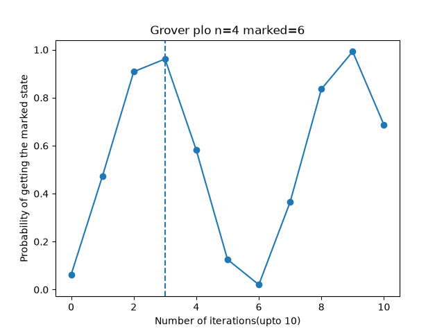

# P1 - Quantum Circuit Simulator with gates and algorithmns

## Features

- Includes the following gates
  - H
  - X
  - Y
  - Z
  - CNOT


Circuit applies Kronecker factor to calculate gates for
- All qubits
- Specific qubits

Circuit also uses fast factor method to calculate gates for
- All qubits
- Specific qubits 

Benchmark for the Kronecker method

| qubits | seconds | peak MB |
|---:|---:|---:|
| 12 | 0.1833 | 335.8 |
| 13 | 0.7013 | 1342.4 |
| 14 | ran out of memory (expected) | — |

Benchmark for the fast method

| qubits | seconds | peak MB |
|---:|---:|---:|
| 12 | 0.000037 | 0.13 |
| 13 | 0.000036 | 0.26 |
| 14 | 0.000193 | 0.53 |
| 15 | 0.000546 | 1.05 |
| 16 | 0.000767 | 2.10 |
| 17 | 0.001240 | 4.20 |
| 18 | 0.002053 | 8.39 |
| 19 | 0.004727 | 16.78 |
| 20 | 0.010391 | 33.56 |
| 21 | 0.021196 | 67.11 |

### Reason why fast method is superior
The Fast method includes reshape to 2 * n dimensions(tensor of specified bits as dimension, e.g. 2x2 for 2 qubits, 2x2x2x2 for 4 qubits) and tensordot, giving a 2**n speedup(exponential speedup) compared to Kronecker product, with less ram usage
## Example usage

```python
# Generation of bell state using Circuit class
from qsim.circuit import Circuit
c = Circuit(2).h(0).cx(0, 1)

# If you want a verbose output of the calculations that are happening behind the scenes
print(c.run(verbose=True))

# Base circuit execution
print(c.run())
```

## How to run pytest
Switch to root folder('p1-circuit-simulator') if you arent already there
Then run
```bash
pytest
```
in the terminal

## Algorithms

### Deutsch Jozsa algorithm
Mainly used as a prop tool to explain why a qubit can be superior to a classical bit in specific scenarios, it is an amazing and effective tool at showing entanglement and interference in process, by using balanced and constant states

A good analogy would be using doors, and there is a specific amount of gold hidden behind the doors
Either there is gold in an equal amount of doors as there is none(half half, thus balanced)
Or there is no gold(constant)
Or they all contain gold(constant as well)

Our job is to figure out which type of combination the doors have, in the least amount of steps possible
A classic bit would need 2**(n - 1) + 1 checks, as it would need to check every door and remember it
This algorithm does it in ONE STEP, a time complexity of O(1) irrespective on the number of bits

### Grover algorithm
Using the same analogies as before
Similar to the Deutsch Jozsa, but it differs in a key way - only one door will contain 'gold', and the others will not
This algorithm finds which door contains it, by changing the amplitude of the correct answer and flipping it using average amplitudes of the other states. It does so in these two steps
- Phase flip using the oracle(marks the 'door' that contains gold)
- Diffusion --> reflects amplitude about the mean of all amplitudes
The above steps are repeated until the highest probability of the correct answer will be reached in a specified number of steps(around $\frac{\pi}{4} \sqrt{N}$)
Time complexity is the number of rounds taken --> $\frac{\pi}{4} \sqrt{N}$

## Conventions

- **Qubit numbering** - qubit 0 is the *leftmost* bit(indexing format used in coding)
                    ; The class Circuit takes normal n inputs of qubits
                    - E.g. Circuit(3) is a circuit for 3 qubits

- **Gate application** - gates act on `gates @ state`

## Results


*Grover probability peaks at around √N rounds, then falls - more iterations past that point drop to near zero, and cycle back to the same peak*

A Grover circuit for n=4, marked=6 compiles to:
- Gate count: `70`
- Depth: `25`

## Layout

```
qsim/
  gates.py       H, X, Y, Z, CNOT matrices
  state.py       zero_state, Kronecker apply, fast (tensordot) apply
  measure.py     probabilities, sample, marginal_probabilities
  circuit.py     Circuit class: gate recording, run, gate_count, depth
  algorithms.py  Deutsch-Jozsa, Grover, oracle builders
tests/           pytest suite, one file per module above
benchmarks/      timings.py - Kronecker vs fast method benchmark
plot_grover.py   generates results_grover_plot/grover_success.png
```

## Limitations

State vector size grows as `2^n`, so does memory. The benchmark table above already shows 21 qubits at 67 MB with the fast method - each extra qubit roughly doubles that, so this simulator tops out at around 25-27 qubits on a typical machine before running out of RAM. The Kronecker method is far more limited still, failing by 14 qubits.